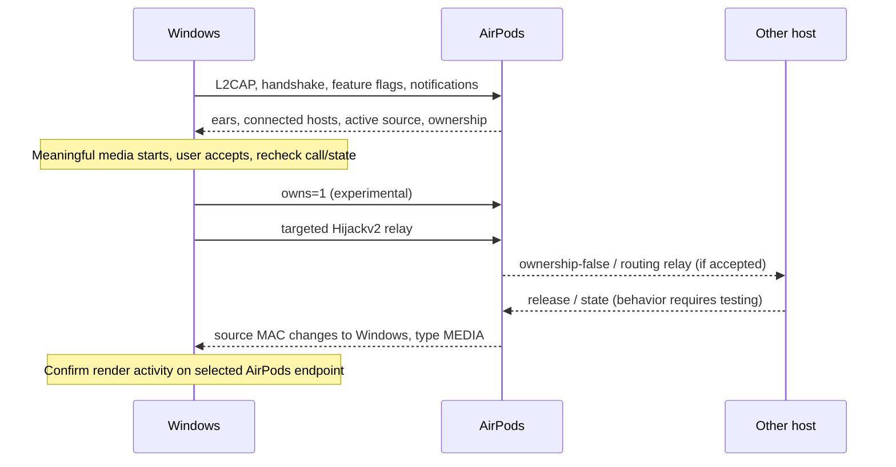

# AACP switching model

**VERIFIED IN SOURCE:** layouts and interaction below come from pinned LibrePods
`AACPManager.kt`, `AirPodsService.kt`, `MediaController.kt`, `docs/opcodes.md` and
`docs/control_commands.md`. See [source mapping](UPSTREAM_MAP.md).
Some linked format documents listed in `opcodes.md` do not exist in the audited tree.
Use executable parsers/builders as evidence and retain undocumented-field uncertainty.

## Layers and framing

AACP uses **Classic L2CAP PSM 0x1001**, service UUID
`74ec2172-0bad-4d01-8f77-997b2be0722a`. It is separate from BLE advertisements,
GATT, A2DP and RFCOMM. The handshake is a special 16-byte SDU. Ordinary packets have
`04 00 04 00`, followed by a **16-bit little-endian** opcode and payload.
L2CAP SDU boundaries matter: do not split an arbitrary byte stream on a header pattern
that may also occur inside payload. The driver adapter must preserve one SDU per read.

| Opcode / field | Direction | Role for this app |
|---|---|---|
| `0x4D` | host → buds | Host feature flags; current Android uses D7 mask |
| `0x0F` | host → buds | Subscribe to state notifications |
| `0x04`, `0x06`, `0x1D` | buds → host | Battery, ear state, model/firmware |
| `0x09`, ID `0x06` | both | Write/observe OWNS_CONNECTION; sending is not observation |
| `0x0D` / `0x0E` | query / response | Active source; response payload six-byte reversed MAC plus type |
| `0x2D` / `0x2E` | query / response | Connected host list; response count at byte 8, entries from byte 9 |
| `0x14` | host → buds | Connected-device MAC message; enum/prose exists but format not established by main Android sender |
| `0x10` / `0x11` | relay / response | Targeted host coordination via buds, includes target MAC and serialized routing metadata |

Query opcode names are documented; exact request payloads for `0x0D`, `0x2D`, and
`0x14` are not established by audited Android sender code. Initial implementation
consumes notifications and does not invent payloads or silently send empty requests.
Protocol debug capture must establish a fixture before adding those builders.

Audio source type is NONE=0, CALL=1, MEDIA=2. Unknown type stays unknown and suppresses
automatic prompts. Connected-list MAC is in forward byte order; source/relay sender
MAC is reversed. List entry `info1/info2` are retained as opaque bytes, not host roles.

## Inferred interaction

This diagram is **PLAUSIBLE / REQUIRES TESTING** for the mixed-DID target topology.
Android source also sends media metadata and nearby-UI relays before Hijackv2. Those
builders contain hardcoded Android/iOS app identity, unexplained score fields and
length constants. This project ports the minimum known ownership/Hijackv2 experiment,
not invented Windows replacements for every metadata field. Failure may mean the
missing initialization/metadata is necessary; do not infer impossible multipoint from
one failed minimal sequence.

Reverse uses a `ReverseBannerTapped` relay. An inbound ownership-false request invalidates
pending takeover and cancels any success claim. Automatic undo/reacquisition is disabled;
retain previous observed source and report failure/cancellation without a retry loop.

## State and correlation

Canonical store separates transport, identity, wear, connected list, source, ownership,
media, and render evidence. Each observation has a monotonic timestamp and transport
epoch. Disconnect clears control-derived observations. Events from prior epochs or
older timestamps cannot confirm a pending request. Takeover needs fresh post-request
Windows MEDIA source plus independently correlated AirPods render activity. Default
endpoint selection is neither ownership nor playback proof.

No wire request IDs are known for these notifications. The client uses one pending
takeover with a local request ID, request time, transport epoch and deadline. It never
reports a send result as an acknowledgement. Calls, unknown/stale state, both buds out,
cooldown, stopped media, source conflicts and transport failure suppress/cancel action.

Malformed packets reject atomically: no partial connected list, no zero-filled invented
MAC, no stale battery percentage. Do not copy upstream's too-short source/list bounds
checks or optimistic ownership-cache updates.
